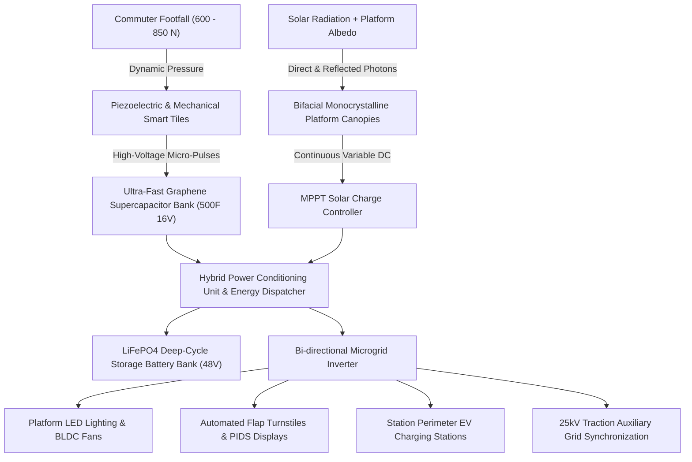

# ⚡ HAR KADAM BIJLI KA (हर कदम बिजली का)
### *A Hybrid Kinetic and Solar Energy System for Railway Stations*

[](https://github.com/0xSouradip/har-kadam-bijli-ka)
[](https://github.com/0xSouradip/har-kadam-bijli-ka)
[](https://github.com/0xSouradip/har-kadam-bijli-ka)
[](https://0xsouradip.github.io/har-kadam-bijli-ka)

---

## 🌟 Executive Summary

**HAR KADAM BIJLI KA** (*Every Step Generates Electricity*) is a next-generation decentralized clean energy ecosystem engineered for high-density public transport nodes, specifically **railway stations**. 

By strategically harvesting two complementary renewable resources:
1. **Dynamic Kinetic Footfall Energy**: Transformed through multilayer piezoelectric ceramics and electromagnetic rack-pinion floor slabs under millions of daily walking commuters.
2. **Bifacial Solar Photovoltaic Canopies**: Capturing direct sunlight and platform albedo reflectance across kilometers of open-sky platform roofing.

This hybrid ecosystem establishes a self-sufficient, climate-resilient microgrid capable of powering station lighting, concourse ventilation, passenger automated turnstiles, and EV charging hubs.

> **Lead Engineer & System Architect**: **SOURADIP GHOSH**  
> **Frontend Engineers**: **ANGSHU SARKAR** & **SNEHA MUKHERJEE**  
> **Theme**: Sustainable Clean Energy & Mobility  
> **Core Focus**: Renewable energy, energy efficiency, sustainable public infrastructure, and innovation.

---

## 🚆 Why Railway Stations?

- **24+ Million Daily Commuters**: Indian Railways alone moves over 24 million passengers every day across 7,300+ stations.
- **Concentrated Compressive Kinetic Forces**: Commuter bottlenecks at ticket gates, foot overbridges (FOBs), and platform stairs deliver consistent mechanical cycles.
- **Kilometers of Rooftop Assets**: Station sheds offer vast, unobstructed surfaces ideal for bifacial solar PV systems without land acquisition costs.
- **Decentralized Consumption**: Generation occurs right where electricity is consumed, eliminating grid transmission and distribution (T&D) losses.

---

## ⚙️ Hybrid System Architecture



---

## 📐 Mathematical Formulation

### 1. Kinetic Piezoelectric & Electro-Mechanical Generation
The open-circuit voltage generated by the piezoelectric stack per step is governed by:
$$V_{oc} = \frac{g_{33} \cdot F \cdot t}{A}$$

Where:
- $g_{33}$ = Piezoelectric voltage coefficient ($~25 \times 10^{-3} \text{ V}\cdot\text{m/N}$)
- $F$ = Dynamic passenger contact force ($600 - 850 \text{ N}$)
- $t$ = Ceramic disk thickness
- $A$ = Active surface contact area

Coupled with a dual-stage pinion gear system, the rotational energy generated over displacement $d$ is:
$$E_{\text{kinetic}} = \frac{1}{2} C V^2 + \int_{0}^{t_{\text{spin}}} \tau(t) \cdot \omega(t) \cdot \eta_{\text{mech}} \, dt$$
*Average measured energy yield: **4.5 to 6.8 Joules per step**.*

### 2. Bifacial Solar Photovoltaic Generation
$$E_{\text{solar}} = A_{\text{canopy}} \cdot \eta_{\text{panel}} \cdot \text{GHI} \cdot (1 + \alpha_{\text{albedo}} \cdot \phi_{\text{bifacial}}) \cdot \text{PR}$$

Where:
- $A_{\text{canopy}}$ = Usable platform shed area ($m^2$)
- $\eta_{\text{panel}}$ = N-Type TOPCon module efficiency ($22.4\%$)
- $\alpha_{\text{albedo}}$ = Concrete platform reflectance ($~0.25 - 0.30$)
- $\phi_{\text{bifacial}}$ = Bifaciality coefficient ($~78\%$)
- $\text{PR}$ = System Performance Ratio ($0.80$)

---

## 💻 Website Features & Interactive Modules

- **Live Interactive Energy Flow Canvas**: Real-time particle physics simulating kinetic compression pulses and solar photon absorption into station busbars.
- **"Step On Tile" Interactive Audio/Visual Simulator**: Tap the virtual piezoelectric tile with synthetic haptic acoustic feedback (Web Audio API) to generate voltage and accumulate Joules.
- **Customizable Station Microgrid Calculator**:
  - Live sliders for Commuter Footfall (5k to 400k), Kinetic Tile count (50 to 1,500), and Solar Canopy Area (500 to 15,000 $m^2$).
  - Dynamic calculations for Daily kWh, Annual MWh, Financial savings in ₹ INR and $ USD, and Carbon offsets.
  - Interactive Chart.js 24-hour diurnal load vs. generation curve.
- **Station Infrastructure Blueprint Map**: Interactive zone explorer covering Foot Overbridges, Automated Turnstiles, Platform Canopies, and Microgrid Vaults.
- **Technical Whitepaper Viewer**: Full engineering synopsis modal with citations and implementation roadmap.

---

## 🛠️ Technology Stack

- **Frontend Core**: Semantic HTML5, Vanilla JavaScript (ES6+)
- **Styling**: Tailwind CSS & Custom CSS3 (Glassmorphism, Neon glow filters, responsive layout)
- **Icons**: Lucide Icons
- **Visual Analytics**: Chart.js
- **Audio Synthesizer**: Web Audio API (Native browser synthesizer for piezo clicks)
- **Animations**: HTML5 Canvas Particle Engine & CSS Keyframe Transitions

---

## 🚀 Running Locally

1. **Clone the repository**:
   ```bash
   git clone https://github.com/0xSouradip/har-kadam-bijli-ka.git
   cd har-kadam-bijli-ka
   ```

2. **Open in any modern browser**:
   - Double click `index.html` or open via browser.
   - Or serve with any lightweight HTTP server:
     ```bash
     npx serve .
     # or python:
     python -m http.server 8000
     ```

---

## 👥 The Innovation Team

We are a group of passionate engineering students dedicated to creating sustainable, climate-resilient technologies for public transit infrastructure.

|  |  |  |
| :---: | :---: | :---: |
| **SOURADIP GHOSH** | **ANGSHU SARKAR** | **SNEHA MUKHERJEE** |
| **Lead Engineer & System Architect** | **Frontend Engineer** | **Frontend Engineer** |
| *Engineering Student* | *Engineering Student* | *Engineering Student* |
| System design, kinetic modeling & microgrid architecture | Interactive controls, Web Audio simulator & UX state | Diurnal load analytics, ESG indicators & telemetry UI |
| [GitHub](https://github.com/0xSouradip) • [Email](mailto:ghoshsouradip02@gmail.com) | [GitHub](https://github.com/0xSouradip/har-kadam-bijli-ka) | [GitHub](https://github.com/0xSouradip/har-kadam-bijli-ka) |

---

## 📜 License & Citation

This project is open-source under the [MIT License](LICENSE).  
Developed by **Souradip Ghosh**, **Angshu Sarkar**, and **Sneha Mukherjee** for **HAR KADAM BIJLI KA**.
